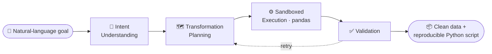

<div align="center">


<br/>

[](https://linkedin.com/in/azfar-shaikh-04063a29b)
[](mailto:azfarshaikh7860@gmail.com)
[](https://doi.org/10.55041/IJSREM53468)


</div>


## 👋 About Me

I'm an **M.Sc. Data Science student at Hochschule Bielefeld (HSBI), Germany** and a **B.E. Information Technology graduate** (Sinhgad College of Engineering, Pune, CGPA 8.69/10). I build production-grade **LLM-based agentic systems**, data pipelines and full-stack AI products.

```yaml
name:        Mohammad Azfar Shaikh
role:        AI & ML Engineer | Full Stack Developer
location:    Bielefeld, Germany 🇩🇪
studying:    M.Sc. Data Science (Research Master), HSBI, 2026 to 2028
founder_of:  Printmax, an AI SaaS used by 100+ students
focus:       Agentic LLM systems, ETL pipelines, LLM inference, AI infrastructure
languages:   English (fluent), German (A1, learning)
open_to:     Working-student roles, internships, research collaborations
```


## 💼 Experience

| Role | Company | Period |
|:--|:--|:--|
| 🤖 **AI & ML Intern** | EkamVistar Consultancy LLP, Pune | Mar 2026 – Aug 2026 |
| 🌐 **Web Developer Intern** | MotionCut (Education), Remote | Jan 2025 – Feb 2025 |

<details open>
<summary><b>🔎 AI & ML Internship highlights</b></summary>
<br/>

- Designed **multi-agent AI pipelines** with **LangGraph, LangChain and Google Gemini** for data mapping, validation, transformation, anomaly detection and audit workflows
- Built scalable **ETL / ingestion pipelines** (REST APIs, CSV/Excel, webhooks, databases, Kafka) with **FastAPI, Celery, Redis and PostgreSQL**
- Developed canonical schema transformation layers, configurable field-mapping engines and validation rule systems for **multi-tenant** data processing
- Orchestrated batch and real-time workflows with **Mage AI**, containerized with **Docker**, managed migrations with **Alembic**
- Integrated **Cloudflare R2**, **LangSmith** tracing for agent observability, and agentic document generation with LangGraph state machines

</details>


## 🚀 Featured Projects

<div align="center">

<a href="https://github.com/Azfarsh/smartp"></a>
<a href="https://github.com/Azfarsh/Llama-wrangler"></a>
<a href="https://github.com/Azfarsh/Scanova3"></a>
<a href="https://github.com/Azfarsh/Ascend-Mentor"></a>

</div>

| Project | What it does | Stack |
|:--|:--|:--|
| 🖨️ **[Printmax](https://github.com/Azfarsh/smartp)** | AI-powered on-demand printing SaaS used by **100+ students**: remote orders, AI photo enhancement, real-time tracking, nearest print-shop discovery | Django, Firebase, Google Maps API, Cloudflare |
| 📊 **[Axel AI](https://github.com/Azfarsh/Llama-wrangler)** *(final-year project)* | Describe data-cleaning goals in plain English; a 4-agent pipeline plans, executes and validates the transforms | React, FastAPI, Gemini, pandas, scikit-learn |
| 🩺 **[Scanova](https://github.com/Azfarsh/Scanova3)** | AI healthcare platform: voice-based Parkinson's screening, chest X-ray detection, skin cancer module | React, Flask, TensorFlow, IBM Cloud |
| 🎯 **[AscendMentor](https://github.com/Azfarsh/Ascend-Mentor)** | AI career platform: skill-gap analysis, roadmaps, resume feedback, mock interviews | React, Node.js, Firebase, Gemini |
| 🎓 **[Agneepankh](https://github.com/Azfarsh/Agneepankh)** | Role-based platform to identify academia-industry alignment gaps | React, Node.js, MongoDB, Firebase |

### 🧩 How Axel AI works

Gemini produces structured plans, while pandas applies deterministic transforms. This keeps LLM reasoning separate from direct data edits.




## 🧑‍💻 Tech Stack

<div align="center">

| | |
|:--|:--|
| **🤖 AI / ML** |        |
| **⚙️ Backend & Pipelines** |         |
| **🎨 Frontend** |      |
| **🗄️ Data & Cloud** |       |
| **🛠️ DevOps & Tools** |       |

</div>


## 🏆 Achievements & Publication

- 🥇 **9th Rank**, IBM SkillBuild Hackathon (AI / cloud innovation challenge)
- 🚀 Founded **Printmax**, a production-ready AI SaaS startup during undergraduate studies
- 📄 R. Uplanchiwar, **A. Shaikh**, S. Sayyed, P. Bhagyawant, S. S. Gadekar, *"LLAMA Wrangler: An Intelligent and Secure Data Wrangling Platform Using LLM"*, IJSREM, vol. 9, no. 11, 2025. [DOI: 10.55041/IJSREM53468](https://doi.org/10.55041/IJSREM53468)


## 📊 GitHub Analytics

<div align="center">


<br/>


</div>

<br/>

<div align="center">

### 🤝 Let's build something together

*Open to working-student roles, internships and collaborations in AI/ML and data engineering.*

[](mailto:azfarshaikh7860@gmail.com)


</div>
